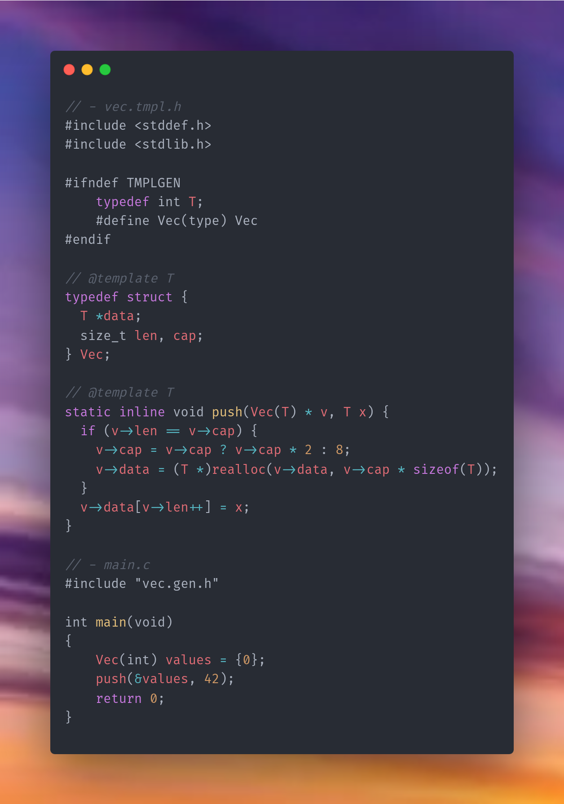

<h1 align="center">c-tmplgen</h1>

<p align="center">
  <strong>Generic C. Specialized at build time.</strong><br>
  Write reusable C templates. Infer concrete types from real call sites.<br>
  Generate ordinary C that's statically dispatched without runtime cost.
</p>

<p align="center">
  <a href="https://en.cppreference.com/w/c/99"></a>
  <a href="https://clang.llvm.org/doxygen/group__CINDEX.html"></a>
  <a href="doc/paradigm.md"></a>
  
</p>

<p align="center">
  <a href="#quick-start">Quick Start</a> ·
  <a href="#highlights">Features</a> ·
  <a href="doc/usage.md">Usage</a> ·
  <a href="doc/constraints.md">Constraints</a> ·
  <a href="doc/reflection.md">Reflection</a> ·
  <a href="doc/plugins.md">Plugins</a> ·
  <a href="doc/paradigm.md">How It Works</a> ·
  <a href="#develop-and-test">Tests</a>
</p>

---

<p align="center">
  <a href="code.png"></a>
</p>

`tmplgen` is a source-aware generic-template generator for C. Mark the type
variables used by a declaration; libclang analyzes your project’s source and
infers the concrete specializations it needs. `tmplgen` emits concrete types,
functions, and compile-time dispatch macros. Your application then builds with
its normal C compiler.

It keeps the implementation in C without adding a runtime generic-object or
reflection layer. The generator is written in C99; libclang is needed when
generating, not when compiling the generated application.

## Quick start

### 1. Build `tmplgen`

Install a C compiler and the libclang development headers and library, then run
from the project root:

```sh
make
```

### 2. Generate concrete code

```sh
./tmplgen --template-dir test/tmpl --output test/gen/all.gen.h \
  --clang-arg=-std=c23
```

The generator’s normal project defaults are `tmpl/` and `gen/all.gen.h`, with
the source root set to `.`. This repository keeps its example project under
`test/`, so the command above selects `test/tmpl/` and `test/gen/` explicitly;
the source root remains the repository root.

### 3. Call the generic API

This repository’s `test/tmpl/math.tmpl.h` declares `max` with a type variable.
The call below is enough for the generator to infer the concrete type and emit
the matching implementation and dispatch association:

```c
#include "test/cases/test_types.h"
#include "test/gen/all.gen.h"

int main(void)
{
    TestInt low = 1;
    TestInt high = 2;
    return max(low, high) != 2;
}
```

For a walkthrough of your own templates and build integration, start with
[Usage](doc/usage.md). Headers that declare types used as template arguments
need an `#ifndef`/`#define` include guard, and the generated header goes after
them; see [Include generated headers after your
types](doc/usage.md#include-generated-headers-after-your-types).

## Highlights

| | |
| --- | --- |
| **Source-driven inference** | Infer type arguments from function inputs and constructor uses—no per-call type tables. |
| **Concrete C output** | Emit real specialized structs and functions that ordinary C tools can inspect. |
| **Compile-time dispatch** | Select observed specializations through `_Generic` or GNU builtins, with no runtime type lookup. |
| **Expressive constraints** | Require structural fields with `<:` or assert compile-time properties with satisfaction annotations and `@where`. |
| **Reflection** | `--reflect=project` adds type ids, layout tables, `typetag_of`/`enumtag_of`/`any_of`, and compile-time checks of sizes, offsets, and enumerator values (all but bit-field positions) for every project type ([Reflection](doc/reflection.md)). |
| **Two output modes** | Use convenient header-only output, or move implementations into `.gen.c` files with `--compiled`. |
| **Incremental analysis** | Reuse validated whole-project and per-source facts; check generated files with `--check`. |
| **Value & constructor parameters** | Pass compile-time integers (`Array(T, 4)`) and whole template type constructors (`Boxed(Option)`) to templates. |
| **Explicit type arguments** | Demand a type that appears only in a return value with a `typename T` pseudo-parameter. |
| **Field metadata** | Attach `@meta` objects to generated fields and read them from the reflection tables. |
| **Optional plugin adapters** | Invoke the shared generator core from Clang and plugin-enabled clangd. |

Generated dispatch can use C11 `_Generic`, GNU type-selection builtins, automatic
backend selection, or suffixed functions without dispatch macros. The chosen
backend must be supported by the application compiler; see
[Tooling](doc/tooling.md).

## Documentation

| Guide | What’s inside |
| --- | --- |
| [Usage & template syntax](doc/usage.md) | Annotations, type inference, value and constructor parameters, CLI options, and output modes |
| [Constraints](doc/constraints.md) | Structural subtyping, compile-time satisfaction, examples, and diagnostics |
| [Reflection](doc/reflection.md) | Type ids, layout tables, `Any`, enum tags, field metadata, and reflection inside templates |
| [Tooling & integration](doc/tooling.md) | libclang, compiler flags, clangd, diagnostics and `#line` mapping, caches, and tests |
| [Plugin modes](doc/plugins.md) | Build and load the optional Clang frontend and clangd feature-module plugins |
| [Design & alternatives](doc/paradigm.md) | The specialization model and trade-offs versus hidden metadata, pointer-fictions, `void *`, `_Generic`, repeated-include templates, C++, and script generators |
| [Benchmarks](test/bench/README.md) | Benchmark methodology, workload controls, and recorded results |

## Develop and test

```sh
./test/run.sh
CC=clang ./test/run.sh
./test/negative.sh
```

Edit the `.tmpl.h` files and regenerate; files under `test/gen/` are generated
outputs. For the implementation model and a candid comparison with other
generic-programming approaches, see [Design & alternatives](doc/paradigm.md).
